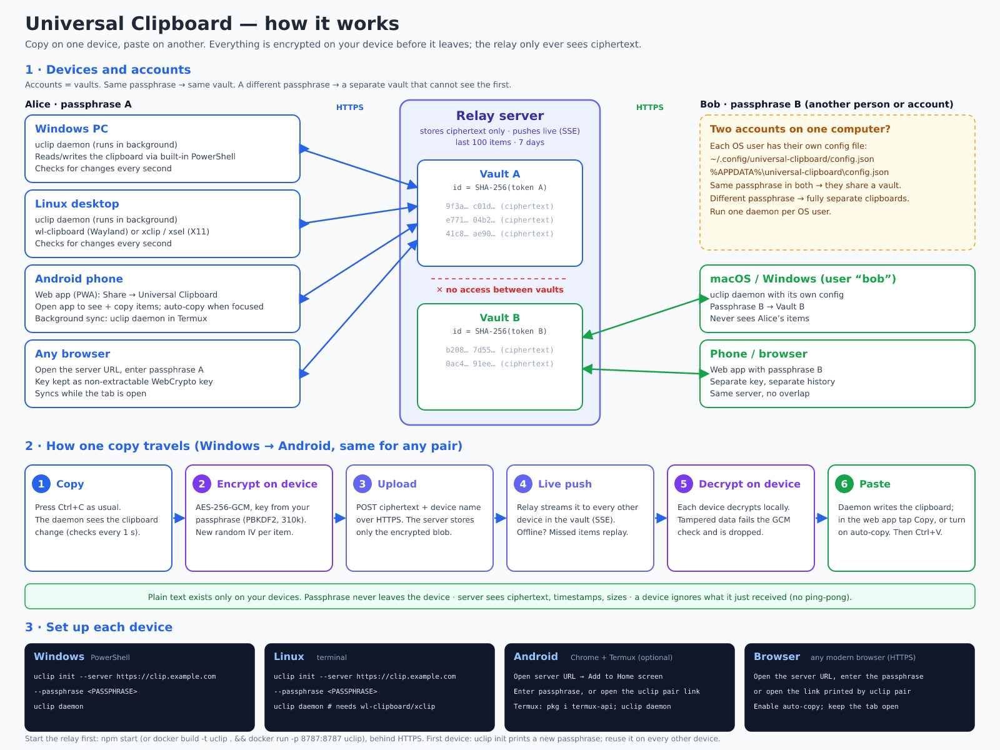

# Universal Clipboard

A private, synchronised clipboard for Windows, Linux, Android and browsers.
Copy on one device, paste on another. Zero runtime dependencies (Node ≥ 20).

## How it works



(Vector version: [docs/how-it-works.svg](docs/how-it-works.svg).)

```
 Windows / Linux / Termux           Browser / Android PWA
   uclip daemon  ──encrypted──►  relay server  ◄──encrypted──  web app
        ▲                       (sees ciphertext only)             ▲
        └──────── same passphrase ⇒ same vault, same key ──────────┘
```

* **End-to-end encrypted.** A passphrase is stretched (PBKDF2-SHA256, 310k iterations) into an
  auth token and an AES-256-GCM key, on the device. The server stores only
  `SHA-256(token)` as the vault id and opaque ciphertext. It cannot read, forge or modify items.
* **Real-time.** Server-Sent Events push new items; clients reconnect with backoff and resume
  from the last sequence number.
* **Bounded retention.** Last 100 items, 7 days (`UC_MAX_ITEMS`, `UC_TTL_HOURS`). Delete any item or clear all.
* **No accounts.** A vault exists the first time someone connects with a new passphrase.
  Set `UC_INVITE_CODE` to stop strangers creating vaults on your server.

## Quick start

```bash
# 1. Run the relay (put it behind HTTPS, see below)
npm start                      # http://127.0.0.1:8787
# or: docker build -t uclip . && docker run -p 8787:8787 -v uclip-data:/data uclip

# 2. On each computer
node cli/uclip.js init --server https://clip.example.com     # prints a new passphrase
node cli/uclip.js daemon                                      # starts syncing

# 3. Second computer: reuse the passphrase
node cli/uclip.js init --server https://clip.example.com --passphrase xxxxx-xxxxx-...

# 4. Phone / browser: open the server URL and enter the passphrase,
#    or run `uclip pair` and open the printed link (the secret is in the #fragment, never sent to the server).
```

`npm link` (or copy `cli/`, `shared/` anywhere) installs the `uclip` command.

### Platforms

| Platform | How | Clipboard tool |
|---|---|---|
| Windows | `uclip daemon` | built-in PowerShell (`Get/Set-Clipboard`) |
| Linux (Wayland) | `uclip daemon` | `wl-clipboard` |
| Linux (X11) | `uclip daemon` | `xclip` or `xsel` |
| macOS | `uclip daemon` | `pbcopy`/`pbpaste` |
| Android | install the web app (Chrome → *Add to Home screen*): Share → *Universal Clipboard* sends text; open the app to copy items. For background sync run `uclip daemon` in **Termux** with `termux-api` | `termux-clipboard-*` |
| Any browser | open the server URL | Async Clipboard API |

Browsers and Android do not allow silent background clipboard access, so the web app syncs while open
(optionally auto-copying incoming items when focused). Full background sync on Android needs Termux.

### HTTPS is required for the web app

Browsers only expose WebCrypto and the Clipboard API on `https://` (or `localhost`). Put the relay behind
Caddy/nginx/Cloudflare Tunnel/Tailscale Serve. Disable proxy buffering for `/api/v1/events` (the relay sends `X-Accel-Buffering: no`).

## CLI

```
uclip init --server <url> [--passphrase <p>] [--device <name>] [--invite <code>]
uclip daemon | copy [text] | paste | history [-n 10] | pair | clear | status
```
Config lives in `~/.config/universal-clipboard/config.json` (`%APPDATA%\universal-clipboard` on Windows), mode 0600.
It contains the passphrase, so protect it like an SSH key.

## Server configuration

| Env var | Default | |
|---|---|---|
| `HOST` / `PORT` | `127.0.0.1` / `8787` | bind address |
| `UC_DATA_DIR` | `./data` | where `vaults.json` (ciphertext) is stored |
| `UC_INVITE_CODE` | *(none)* | required (`X-Invite-Code`, `uclip init --invite`) to create a vault |
| `UC_MAX_VAULTS` | `100` | |
| `UC_MAX_ITEMS` / `UC_TTL_HOURS` | `100` / `168` | retention per vault |
| `UC_MAX_BODY_BYTES` | `1000000` | max item size |

## Security notes and limits

* Security equals passphrase strength. Generated passphrases have ~198 bits; if you choose your own, use a long one.
  The KDF salt is fixed (there is no account to hold a per-user salt), so weak passphrases are vulnerable to offline guessing by anyone who obtains the server's data or the token.
* The server and anyone on the network path see metadata: timestamps, item sizes, IP addresses. Use TLS.
* The sign-in link and the CLI config both contain the passphrase. The browser stores only a non-extractable derived key (IndexedDB), never the passphrase.
* Text only for now. Images/files are not yet supported.
* The daemon polls the clipboard once a second (native tools have no change events); set `UCLIP_POLL_MS` to tune.
* Clipboard managers' "sensitive" flags (e.g. password managers) are not honoured. Stop the daemon when copying secrets you do not want synced.

## Development

```bash
npm test      # crypto, relay API, SSE resume, retention, auth isolation, and two real daemons syncing end-to-end
```

Layout: `server/` relay · `shared/` crypto + API client (used by browser and CLI) · `web/` PWA · `cli/` daemon.

## Status

Verified by the automated tests above on Linux/Node 24 using a file-backed fake clipboard.
**Not yet verified on real hardware:** the Windows PowerShell backend, Wayland/X11/Termux backends, and the browser UI/PWA/share-target on Android.
